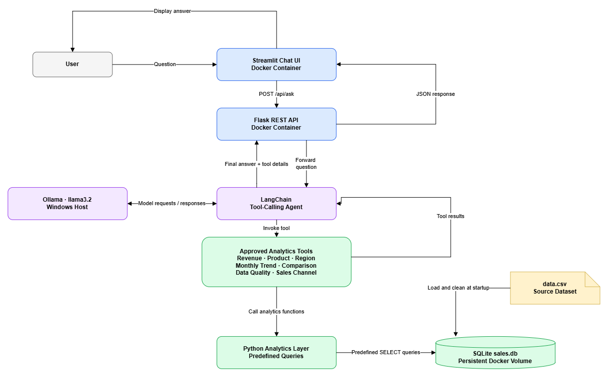

# Mini AI Business Intelligence Assistant

A lightweight Business Intelligence (BI) assistant that answers natural-language questions about sales data using a tool-calling AI agent, Python analytics, and SQLite.

Built for the **RSG AI-Assisted Development Challenge**.

## 1. Overview

The Mini AI Business Intelligence Assistant allows users to ask questions about sales performance through a chat-style interface. The application uses an LLM to interpret questions and select relevant analytics tools. Python and SQLite perform the underlying calculations, and the LLM turns the results into a readable response.

The application is designed to keep business calculations grounded in database results rather than relying on the LLM to invent numerical answers.

### Key features

- Natural-language questions about sales data
- Tool-calling agent built with LangChain and Ollama
- SQLite database populated from a CSV file
- Predefined analytics functions for revenue, products, regions, monthly trends, and data quality
- Flask REST API
- Streamlit chat interface
- Docker Compose deployment
- Request validation and a bounded agent execution loop

## 2. Technology stack

| Component | Technology | Purpose |
|---|---|---|
| User interface | Streamlit | Chat interface and dataset summary |
| Backend API | Flask | Receives questions and returns answers |
| Agent framework | LangChain | Connects the LLM to analytics tools |
| Language model | Ollama with `llama3.2` | Interprets questions and formulates responses |
| Database | SQLite | Stores cleaned sales records |
| Data processing | Pandas | Loads, validates, and transforms the CSV |
| Containerization | Docker and Docker Compose | Runs the application services |
| Testing | Pytest | Automated tests |

## 3. Architecture

The application follows this flow:

1. The user submits a question through the Streamlit interface.
2. Streamlit sends the question to the Flask API.
3. LangChain passes the question to the Ollama model.
4. The agent selects an appropriate registered analytics tool.
5. The tool executes a predefined SQLite query through the Python analytics layer.
6. The agent uses the returned results to formulate an answer.
7. Flask returns a structured JSON response to Streamlit.
8. Streamlit displays the answer and expandable analysis details.

Ollama runs on the Windows host. The Flask and Streamlit services run in Docker containers.


The diagram below shows how the Streamlit interface, Flask API,
LangChain agent, Ollama model, analytics tools, and SQLite database
work together.




## 4. Project structure

```text
Business Agent/
├── app/
│   ├── __init__.py
│   ├── api.py
│   ├── agent.py
│   ├── analytics.py
│   ├── database.py
│   ├── rules.py
│   └── ui.py
├── tests/
│   └── test_v1.py
├── data/
│   └── sales.db             # Generated database location
├── data.csv
├── requirements.txt
├── Dockerfile
├── compose.yaml
├── .dockerignore
└── README.md
```

The exact test filenames and optional files may differ as the project evolves. The `rules.py` module belongs to the original rule-based implementation; the current API should import the active agent from `agent.py`.

## 5. Dataset and database

The application reads `data.csv` and loads the records into a SQLite table named `sales`.

The expected CSV columns are:

- `Transaction_Id`
- `Order_date`
- `Product`
- `Category`
- `Region`
- `Sales_channel`
- `Quantity`
- `Unit_price`
- `Discount_amount`
- `Status`

### Revenue calculation

Net revenue is calculated as:

**Net revenue = Quantity × Unit price − Discount amount**

The current data-cleaning policy includes completed transactions with valid dates and numeric values. Invalid dates, missing or negative numeric values, non-completed statuses, and discounts exceeding gross sales are excluded from revenue calculations.

Excluded records are retained with an inclusion flag and an exclusion reason, allowing the application to report data-quality information.

Duplicate transaction IDs are deduplicated by retaining the first occurrence.

These rules are implementation assumptions and should be reviewed if the business defines revenue or returns differently.

## 6. Supported analytics

The registered analytics tools are intended to support questions such as:

| Analysis | Example question |
|---|---|
| Total revenue | What is the total net revenue? |
| Top product | Which product generated the highest revenue? |
| Monthly trend | Show the monthly revenue trend. |
| Top region | Which region generated the highest revenue? |
| Monthly comparison | Compare revenue between January and February 2026. |
| Data quality | Which records were excluded and why? |
| Sales channel | Which sales channel was used most frequently? |

The sales-channel question is supported only if `get_top_channel` is registered in `app/agent.py` and its corresponding analytics function exists in `app/analytics.py`.

The agent's ability to answer a question depends on the registered tools, the available data, and the model's tool-calling behavior. Unsupported questions should receive a clear explanation rather than a fabricated result.

## 7. Prerequisites

Install or have available:

- Docker Desktop for Windows
- Python 3.10 or newer for local development and tests
- Ollama installed on Windows
- The `llama3.2` model downloaded
- The project source files and `data.csv`

Download the model from PowerShell:

```powershell
ollama pull llama3.2
```

Confirm that Ollama is responding:

```powershell
Invoke-RestMethod http://localhost:11434/api/tags
```

## 8. Running with Docker

### Configure Ollama

The Flask container connects to the Windows host through:

```text
http://host.docker.internal:11434
```

The API service should use the following environment variables:

```yaml
environment:
  CSV_PATH: /app/data.csv
  DB_PATH: /app/data/sales.db
  OLLAMA_BASE_URL: http://host.docker.internal:11434
  OLLAMA_MODEL: llama3.2
```

Ensure the Compose configuration includes a persistent volume for `/app/data`.

If Ollama is not reachable from Docker, check its listening address and Windows firewall configuration. Exposing Ollama beyond localhost can allow other devices to access it, so restrict access to trusted networks.

### Build and start

From the project root:

```powershell
docker compose up --build -d
```

Check service status:

```powershell
docker compose ps
```

View API logs:

```powershell
docker compose logs -f api
```

View all service logs:

```powershell
docker compose logs -f
```

### Application URLs

| Service | URL |
|---|---|
| Streamlit UI | http://localhost:8501 |
| Flask health endpoint | http://localhost:5000/health |
| Dataset summary | http://localhost:5000/api/summary |

### Stop the application

```powershell
docker compose down
```

This stops and removes the containers while retaining the named database volume. Avoid `docker compose down -v` if you want to preserve that volume.

## 9. API endpoints

### Health check

```http
GET /health
```

Returns the service status.

### Dataset summary

```http
GET /api/summary
```

Returns summary metrics such as total revenue and included and excluded transaction counts.

### Ask a question

```http
POST /api/ask
Content-Type: application/json
```

Example request:

```json
{
  "question": "Which product generated the highest revenue?"
}
```

The response includes a natural-language answer and, where provided by the active agent implementation, metadata such as the model name and intermediate tool-call details.

## 10. Testing

Run the automated tests from the project root in a local Python environment:

```powershell
py -m venv .venv
.\.venv\Scripts\Activate.ps1
pip install -r requirements.txt
pytest -q
```

Tests should cover:

- API health
- Dataset summary
- Total revenue
- Top product
- Monthly trend
- Top region
- Month-to-month comparison
- Data-quality reporting
- Invalid requests
- Unsupported questions

Record the actual test results before submitting. Do not report tests as passing unless they have been executed successfully.

## 11. Safety and reliability

- Analytics tools use predefined queries rather than executing user-supplied SQL.
- The LLM is expected to use tool results as the source of truth for numerical answers.
- The agent has a bounded execution loop to limit repeated tool calls.
- API requests validate that the question is a non-empty string and enforce a length limit.
- Model and API timeouts should be configured appropriately for local inference.
- The agent must not claim that a tool ran unless the tool was actually invoked.
- Revenue changes should not be attributed to marketing, seasonality, or other causes unless supporting evidence exists.

A language model can still produce incorrect interpretations or unsupported explanations. Tool execution, returned figures, and edge cases therefore need to be tested explicitly.

## 12. Known limitations

- The agent's accuracy depends on the model's ability to select and use tools correctly.
- Local model inference can be slow, particularly on resource-constrained machines.
- Visual conversation history in Streamlit does not automatically provide conversational memory to the agent.
- The current analytics are limited to the functions implemented in the Python analytics layer.
- Relative-date questions, such as “last month,” require explicit handling to select the correct months.
- The CSV is the source used to initialize the database. If the application replaces the sales table at startup, changes made directly to the database may be overwritten.
- The application does not establish causal explanations from revenue data alone.

## 13. AI-assisted development

AI assistance was used during development to help design the application structure, draft Python modules, create analytics functions, configure LangChain and Ollama integration, troubleshoot Docker connectivity, and improve the user interface.

The application logic, data-cleaning policy, tool definitions, and test results should be reviewed and verified by the developer before submission. AI-generated code and explanations should not be treated as verified without testing.

## 14. Future improvements

Potential next steps include:

- Persistent conversational memory
- More analytics tools and multi-step analysis
- Improved handling of relative dates and ambiguous questions
- Better visualizations for monthly and regional trends
- Additional unit, integration, and failure-mode tests
- Retrieval-Augmented Generation (RAG) for business documents and policies, if document-based questions are required

## 15. Project objective

The objective is to demonstrate a practical business intelligence application that combines natural-language interaction with deterministic data analysis. The LLM helps interpret and explain questions, while the database and Python analytics layer provide the numerical results.
